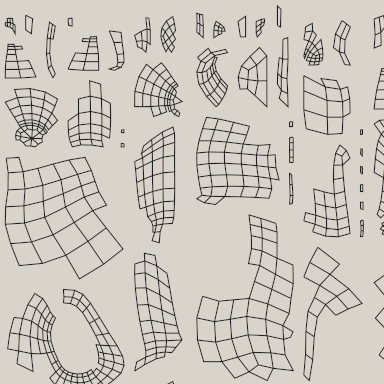
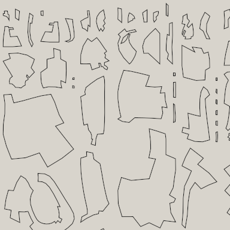
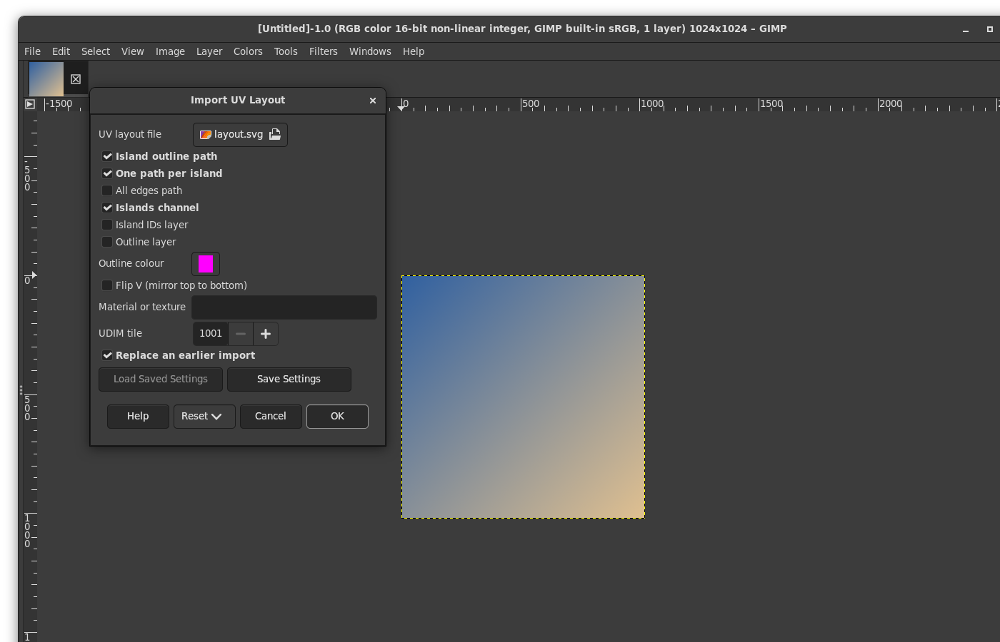
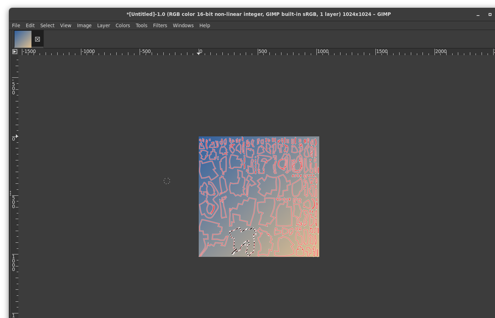
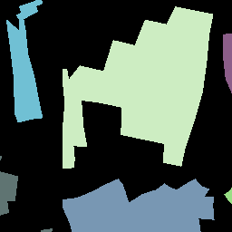
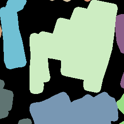
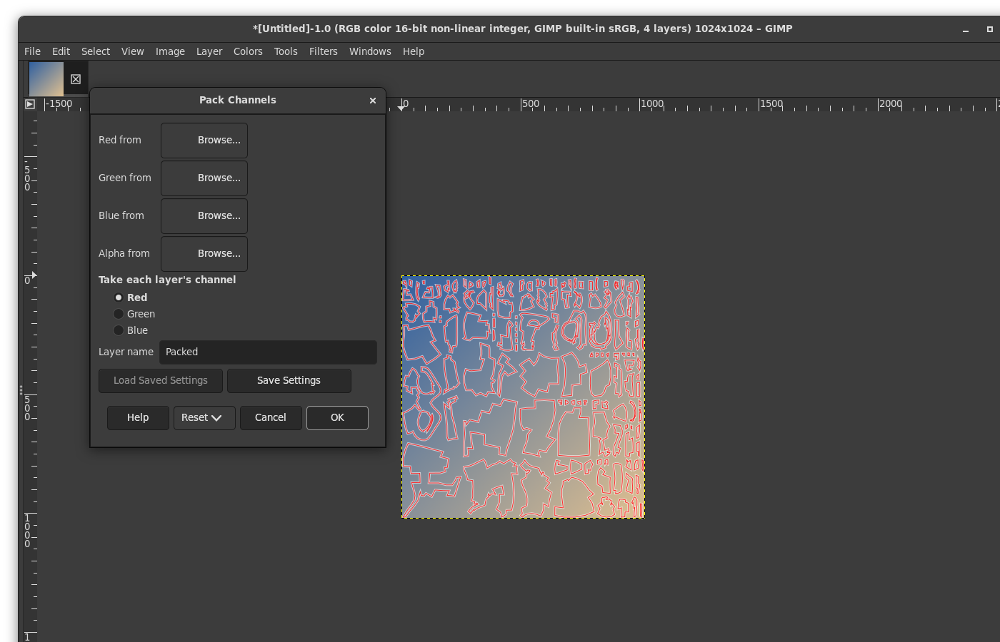

# UV Tools for GIMP 3

A GIMP 3 plug-in for painting textures on UV layouts. It reads the UV
layout of a model and gives you, in GIMP:

- the **outlines of the UV islands only**, without the internal edges
  of every face, as a path shown on the canvas;
- **one path per island**, and a way to **select an island** by pointing
  at it with a small selection;
- an **islands channel** (all islands, as a mask);
- **seam bleed**: the islands' pixels spread outward by N pixels, each
  from its nearest island pixel;
- **fill outside the islands** with a colour, or clear it;
- **channel packing and unpacking** (for example occlusion, roughness,
  metallic into R, G, B), with the numbers kept as they are.

It works with the UV layout SVG that Blender exports, with OBJ files
(Blender, Blockbench, Maya, Substance and most other 3D programs write
them) and with Blockbench projects (.bbmodel). Tested with GIMP 3.2.6
(Flatpak), Blender 5.2 and Blockbench's file format as of its source of
September 2026.

| Every edge (Blender's UV export) | UV Tools' island outline |
|---|---|
|  |  |

## The tools

Everything is under **Image > UV Tools**; Select UV Islands is also in
the **Select** menu. Every tool is one undo step, and every one can be
called from scripts (the procedures are listed at the end).

### Import UV Layout

Choose the layout file. The layout's 0..1 square is stretched over the
whole image, so make the image the size of the texture first (UV Tools
says so when the layout's shape does not match the image's). You get:

- **UV Islands** (path, shown): the outer boundary of each island and
  its holes. No internal edges. Paths are drawn on the canvas but are
  not part of the picture; switch them off in the Paths dialog.
- **UV Island 1 ... N** (paths, hidden): one per island.
- **UV Edges** (path, optional): every face edge, like Blender's export.
- **UV Islands** (channel): all islands. A pixel is in it when its
  centre is inside a face (on an edge counts as inside), the same rule
  as GIMP Link for Blender's island masks.
- **UV Island IDs** (layer, optional, hidden): each island in a colour of
  its own, for the Fuzzy Select tool.
- **UV Outline** (layer, optional): the outline drawn into a layer, in a
  colour you choose.

Options: **Flip V** mirrors the layout top to bottom, for UVs made with V
pointing down; **Material or texture** takes only the faces of one OBJ
material or one Blockbench texture; **UDIM tile** chooses the tile of an
OBJ (1001 is 0..1). Importing again replaces the earlier import.

Islands are found from the layout itself: faces that share an edge
(running in opposite directions, as neighbouring faces of one island
do) are one island. Two islands that only touch at a corner stay two,
a mirrored copy stacked on an island stays separate, overlapping
islands stay separate, and edges that meet another face's edge only in
part (Blockbench's box UV) are joined.

### Select UV Islands

GIMP does not tell a plug-in where you clicked, so you point at islands
with the selection: drag a small rectangle (or any selection) over an
island, then **Select > Select UV Islands**. Choose what it takes:

- the islands the selection **touches** (the default);
- the island at the selection's **centre**;
- the island with a given **number** (as in the path names);
- **all** islands;

and whether to replace, add to, subtract from or intersect with the
selection. Give it a keyboard shortcut (Edit > Keyboard Shortcuts) and
selecting an island is a small drag and a key.

Two ways without the plug-in: in the Paths dialog, click an island's
path and use Select > From Path; or show the UV Island IDs layer and
click the island with the Fuzzy Select tool (threshold 0, on that
layer).

### Seam Bleed

Spreads the islands' pixels outward by the given number of pixels (1 to
100): every pixel outside the islands within that distance (Euclidean,
between pixel centres) gets the exact value of its nearest island
pixel, all four channels. Island pixels and pixels farther away do not
change. The islands come from the UV Islands channel (or another
channel), the selection, or the layer's alpha (more than half opaque).
With the channel or the alpha, a selection limits where pixels change.

| Before | After, 8 pixels |
|---|---|
|  |  |

It is exact at 8 and 16 bit, half and float (colour and data maps,
straight alpha, colour under alpha 0 kept), and about 4 seconds for a
4096 x 4096 texture with 16 pixels. How it works:
[docs/dilation.md](docs/dilation.md).

To give an exact result, Seam Bleed puts a copy of the layer, with the
result, in the layer's place (same name, mask, mode, opacity and
properties, one undo step): GIMP's usual way for a plug-in to change
pixels rounds them. Scripts should go on with the layer it returns.

### Fill Outside Islands

Fills everything outside the islands with a colour, or makes it
transparent. **Colour as stored numbers** is for data maps in a linear
image: #8080ff then stores 0.502, 0.502, 1 (a flat normal), where
GIMP would otherwise convert the colour to linear light and store
0.216, 0.216, 1.

### Pack Channels and Unpack Channels

**Pack Channels** makes a new layer whose red, green and blue (and
optionally alpha) are the numbers of the chosen layers. With three or
four layers selected, the dialog starts with them as red, green, blue
(and alpha), in the order GIMP passes them; check before OK. For grey
layers any of their channels will do (red by default).
**Unpack Channels** adds a grey layer for each channel of the active
layer.

### Numbers, not colours

GIMP stores each image at one precision (8, 16 or 32 bit integer, half
or float) and in one encoding: linear, or perceptual (sRGB-encoded).
UV Tools reads and writes pixels in the format that matches the storage,
so the numbers go through unchanged: packing copies each number as it
is, at the image's precision; seam bleed copies whole pixels. Nothing
converts a data map. Two things to know: converting an image's
precision in GIMP (Image > Precision) does change the numbers of a data
map, since it treats them as colours; and for data maps, keep the image
at the precision of the file you load and save.

## Install

Copy the folder `uv-tools` (with its four `.py` files) into GIMP's
plug-in folder, so that you have `plug-ins/uv-tools/uv-tools.py`, and
restart GIMP:

- Linux, native or **Flatpak**: `~/.config/GIMP/3.2/plug-ins/` (the GIMP
  Flatpak uses this same folder). On Linux and macOS `uv-tools.py` must
  be executable: `chmod +x ~/.config/GIMP/3.2/plug-ins/uv-tools/uv-tools.py`.
- Windows: `%APPDATA%\GIMP\3.2\plug-ins\`
- macOS: `~/Library/Application Support/GIMP/3.2/plug-ins/`

(Windows and macOS were not tried.) GIMP needs its Python support; the
Flatpak has it. No other packages are needed (no numpy).

## With Blender

In the UV Editor, **UV > Export UV Layout**, format SVG, with **All
UVs** on (else only the selected faces are written), at any size (UV
Tools scales it to the image). For UDIM textures, choose to export the
tiles and import each tile's file into its tile's image. Or export the
model as OBJ (File > Export > Wavefront (.obj), with UV coordinates) and
import that, with the UDIM tile if needed.

## With Blockbench

Blockbench does not export UV layouts as SVG (its "Export UV Mapping" is
a per-face setting, and its templates are images). Import the project
file itself (`.bbmodel`): UV Tools reads the UV rectangles of cube faces
(box UV and per-face UV) and the UVs of mesh faces, at the project's UV
size. Faces without a texture are left out; **Material or texture**
takes one texture's faces (by name or number). Or export the model as
OBJ (File > Export > Export OBJ Model) and import that.

## With GIMP Link for Blender

[GIMP Link for Blender](https://github.com/sandbranch/gimp-blender-link)
edits Blender textures in GIMP. When UV Tools is installed it can use
it for its island paths, islands channel and seam bleed:
[docs/blender-link.md](docs/blender-link.md) says exactly how. You can
also run UV Tools' tools on GIMP Link's images yourself: Import UV
Layout with the `islands-1001.svg` (or `uv-1001.svg`) next to the XCF.

## For scripts

| Procedure | Arguments (besides run mode, image, drawables) | Results |
|---|---|---|
| `plug-in-uv-tools-import` | file, flip-v, material, udim-tile, island-outline, island-paths, all-edges, islands-channel, island-ids-layer, outline-layer, outline-color, replace | islands, faces, outline (path), channel |
| `plug-in-uv-tools-select-islands` | mode (touching, centre, number, all), island, operation (replace, add, subtract, intersect) | count |
| `plug-in-uv-tools-seam-bleed` | radius, islands-from (channel, selection, alpha), islands-channel | drawable (use this one), pixels |
| `plug-in-uv-tools-fill-outside` | islands-from, islands-channel, fill (color, transparent), color, as-numbers | |
| `plug-in-uv-tools-pack-channels` | red, green, blue, alpha (layers), source-channel, name | layer |
| `plug-in-uv-tools-unpack-channels` | with-alpha | count |
| `plug-in-uv-tools-version` | | version, api |

What UV Tools made carries parasites: `uv-tools-outline` on the outline
path, `uv-tools-island` (the number) on each island path,
`uv-tools-islands` on the channel.

## Tests

    tests/run.sh               everything
    UVT_GUI=0 tests/run.sh     without the GUI test
    UVT_SPEED=0 tests/run.sh   without the 4K timings

One command, no network; PASS or FAIL per check and a non-zero exit on
failure. It needs the Flatpaks org.gimp.GIMP and org.blender.Blender,
[GIMP Link for Blender](https://github.com/sandbranch/gimp-blender-link)
next to this folder (for its reference islands and masks), and for the
GUI test a headless Chrome, node 22 and
[gimp-plugin-devtools](https://github.com/sandbranch/gimp-plugin-devtools)
next to this folder.

- **lint**: no em or en dashes, the Python compiles;
- **the model in plain Python** (`tests/unit.py`): SVG edge cases
  (transforms, relative and curved paths, viewBox, islands touching at
  a corner, holes, T-junctions), a Blockbench project written the way
  Blockbench writes one (box UV nets with no inner edges, per-face UV,
  meshes, disabled faces, texture filter), OBJ tiles, materials and
  flipped V;
- **headless Blender** (`tests/blender_make.py`) makes seven layouts: a
  cube, islands with holes, overlapping and stacked mirrored islands,
  islands touching the border, Suzanne unwrapped by Blender, and two
  big meshes (31488 and 125952 faces). For each: Blender's own SVG, an
  OBJ, GIMP Link's SVGs and mask, and the number of islands and
  boundary edges counted on the mesh by GIMP Link's code. Then for all
  four files of each: the same islands and boundary edges, the outline
  exactly the mesh's boundary edges (segment for segment), the mask
  pixel by pixel against GIMP Link's (differences only within the
  files' rounding of an edge), and the time;
- **headless GIMP** (`tests/gimp_test.py`), through the procedures as a
  script calls them: import (paths, channel, IDs and outline layers,
  replacing, OBJ, flip, Blockbench, bad files), selecting islands (by
  number, touching, centre, all; add, subtract, intersect), seam bleed
  against a brute-force reference at 8 and 16 bit, half and float,
  linear and perceptual, RGB and grey, 32-bit integer, channels, moved
  and smaller layers, islands from the channel, the selection or the
  alpha, a selection limiting it, split into tiles; fill outside,
  including a data map's numbers; pack and unpack round trips at every
  precision; the GIMP Link calls; 4K timings;
- **GUI** (`tests/gui/gui-test.sh`): a real GIMP on a Broadway display,
  seen through a headless Chrome: each dialog opens, OK runs it, and one
  Edit > Undo takes back all of it (screenshots in `tests/output/gui/`);
- **your folders**: before and after, the names, sizes and times in
  `~/.config/GIMP/3.2`, `~/.var/app/org.gimp.GIMP`,
  `~/.var/app/org.blender.Blender` and `~/.config/blender` are listed,
  and the run fails if anything changed. GIMP and Blender run with a
  throwaway home and profile under `tests/output` (`tests/isolate.sh`,
  from gimp-plugin-devtools): HOME and the XDG folders inside the
  Flatpak point there and GIO uses no GVFS. Another program using those
  folders during the run makes this check fail too.

`tools/doc-images.sh` makes the pictures in `docs/images` (after a test
run).

## Limits

- The layout covers the image's 0..1; UVs outside it fall outside the
  image (import the UDIM tile you need).
- An SVG's islands are found from its shapes: islands that lie exactly
  on top of each other with the same winding are told apart only by
  the order of their faces in the file (as Blender writes them). GIMP
  Link's islands file names its islands and has no such limit.
- In SVGs, curves are flattened (UV edges are straight) and arcs become
  straight lines; open lines are ignored.
- Seam bleed: radius up to 100 pixels; 32-bit integer and double images
  are exact to float precision only; a layer mask in a float image is
  merged the usual GIMP way (exact at 8 and 16 bit).
- GIMP's dialogs print "no mnemonic for property" warnings for the
  choices shown as radio buttons (GIMP's check does not look into radio
  frames); the options themselves have mnemonics.
- Tested on Linux with the GIMP 3.2.6 Flatpak only.

## License

GPL-3.0-or-later. See [COPYING](COPYING). Written from scratch.
Blender's UV exporter (`io_mesh_uv_layout`) and Blockbench's source
(GPL-3.0) were read to learn their file formats; no code was copied.
